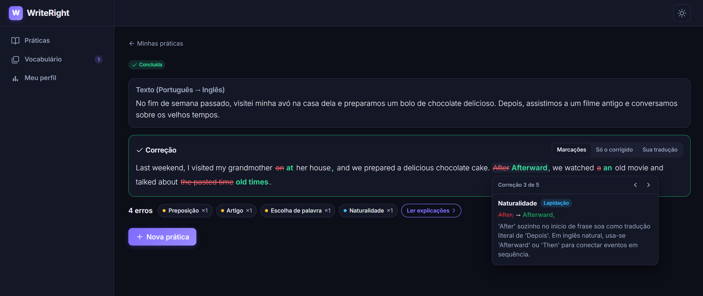
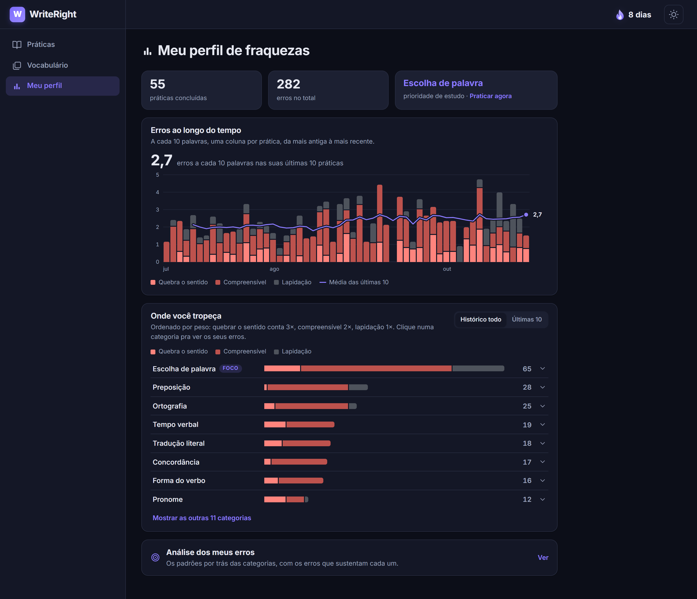
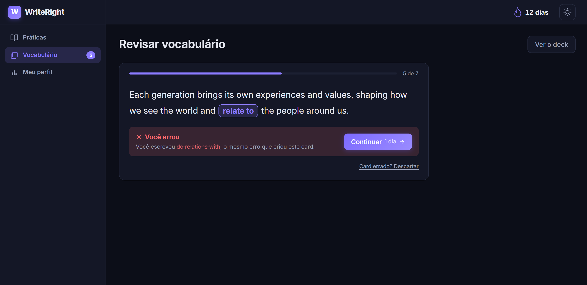
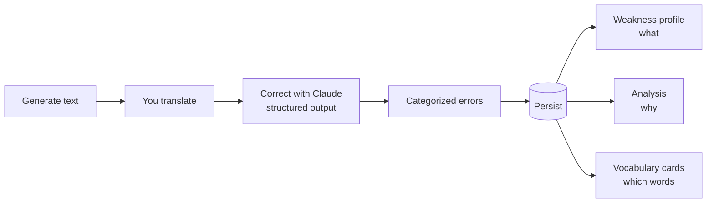

# WriteRight

> AI-powered writing practice: translate texts and get corrections that track your recurring mistakes to focus your studies.

[](https://github.com/AndreBoniatti/write-right/actions/workflows/ci.yml)


WriteRight is a small app I built to practice writing in another language — and to actually use, not just demo. You translate a short generated text, an LLM corrects it and **classifies every mistake into a fixed taxonomy**, and those classifications pile up into a profile of your weaknesses. A second step looks for the patterns behind them, and the vocabulary mistakes come back as flashcards built from what you actually wrote.

It's a personal tool first (I use it to study English) and a portfolio piece second.

## Screenshots

**Correction.** Every change marked in place inside your own translation, struck through and replaced. Click one for its category, severity and explanation, or step through them all in order; below, the mistakes summed up by category.



**Weakness profile.** Errors per 10 words, practice by practice, split by severity — per word, because text length varies and a per-practice count can show progress where there is none. Below, the same categories aggregated (whole history or the last 10 practices).



**Vocabulary review.** A card minted from a real mistake: the corrected sentence with the answer blanked out and the source-language phrase as the hint. On a miss, the answer fills the blank and what you actually wrote comes back struck through — here, the very mistake that created the card.



## The idea: an error memory

Most correction tools tell you what's wrong once and forget it. WriteRight remembers. Every correction feeds the same store, and three views read from it, each answering a different question:



1. **Generate** a short text at your CEFR level, optionally themed.
2. **Translate** it yourself.
3. **Correct** — the model returns the fixed text plus every error, each tagged with a **category** and a **severity**, via structured output (a JSON schema, not free text).
4. **Persist** every categorized error.
5. **Profile** — *what* you get wrong: errors per 10 words over time, and the categories ranked by severity weight.
6. **Analysis** — *why*: a stronger model looks for the patterns behind the categories, and every claim has to cite your real errors.
7. **Deck** — *which words*: vocabulary mistakes come back as flashcards, on a spaced-repetition schedule.

The fixed taxonomy is what makes this work: stable categories mean the profile stays comparable over time, and the model is *required* to classify into them rather than inventing labels.

**What I took out.** The original core of the project was generation aimed at the profile: the next text was written to make your three heaviest categories come up again. I kept switching it off, and the data said why — my heaviest category, `WordChoice`, had 67 errors with 66 different corrections, so there was no rule to aim at. It's gone; the deck and the analysis reach what a category couldn't. The full story is in [ADR 007](docs/decisions/adr-007-remove-profile-targeted-generation.md).

## The taxonomy (the core asset)

A **closed set of 19 categories** — deliberately fixed, because every new category fragments the historical data. Category and severity are separate axes (severity: *breaks meaning* / *understandable* / *polish*), so you can study what actually blocks communication before the fine details.

| Group | Categories |
|---|---|
| **Structure / grammar** | SubjectOmission, VerbTense, VerbForm, Agreement, Article, Preposition, Pronoun, WordOrder, NumberCountability, MissingOrExtraWord |
| **Vocabulary / meaning** | WordChoice, FalseCognate, Collocation, LiteralTranslation |
| **Mechanics** | Spelling, Capitalization, Punctuation |
| **Style** | Naturalness |
| **Escape hatch** | Other (used only when nothing else fits — a high rate here means a category is missing) |

The taxonomy lives in one place (`WriteRight.Shared`) and is the single source of truth: the UI reads its labels from it, and the JSON schema sent to the model derives its allowed values from the same enums, so the two can't drift apart. → [ADR 002](docs/decisions/adr-002-closed-taxonomy-and-structured-output.md)

## Weakness analysis: the *why* behind the categories

The profile tells you **what** you get wrong ("Preposition ×12"). It can't tell you that 8 of those 12 are one rule you never learned — the closed taxonomy that makes the data comparable is also what makes it blind to the pattern inside a bucket.

So a separate screen sends your **real error rows** to a stronger model and asks for the structure behind them, under one rule: **no claim without evidence**. The model must cite the ids of the errors behind every pattern, and the server drops anything that doesn't check out against what it sent. It never sees your texts — with them, it starts asserting things no error can back. Each pattern shows your errors first, then why they happen, then the rule to study, and the page tells you when a saved analysis has gone stale. → [ADR 004](docs/decisions/adr-004-analysis-grounded-in-cited-evidence.md)

## The vocabulary deck: where categories can't reach

A **category** is the right unit for grammar: a rule generalises. Vocabulary doesn't — each lexical item is its own thing. Of 188 errors across 36 practices, **82 (44%) were vocabulary**, and those 82 had **82 distinct corrections**.

So vocabulary mistakes become flashcards, **minted from real errors, never from a word list**. The front is the corrected sentence with the answer blanked out, plus the matching phrase in the *source* language as a hint; the back carries the answer and **what you actually wrote** — your own mistake is the strongest memory hook available.

What becomes a card is decided by its own model call after the correction, and checked by code before it's minted. When the correction's category decided it, 32% of the cards were bad; the separate step and its gate are in [ADR 005](docs/decisions/adr-005-cards-designed-by-their-own-call.md). A few smaller decisions:

- **You type the answer.** Self-rating measures the *feeling* of knowing. Typing gives an objective right/wrong; easy/hard only refines the interval, and a near miss is yours to adjudicate.
- **The hint is language-neutral** — the phrase in the exercise's source language, whichever direction you practised.
- **Cards copy their content** rather than pointing at the error. A card isn't a mirror of its error: a recurring failure rewrites it, and the blank, hint and alternatives are designed, not copied.
- **Failing the same item again while writing reschedules the existing card** instead of minting a second one — and writes no review row, so the review log keeps measuring only spaced recall.
- **At most one card per source sentence per day.** A sentence with three errors mints three cards whose fronts spell out each other's answers — 39 of 75 cards on my deck before this rule.
- **Discarding lives where you notice** — on every revealed card, not only on the deck page, where it was used zero times across 95 cards.
- **The scheduler is boring on purpose.** Plain SM-2: the value is in the card content, not the arithmetic.

## Architecture and decisions

[`docs/`](docs/README.md) has the system on one page — the [architecture haiku](docs/architecture-haiku.md) — and the [decision records](docs/README.md#architectural-decision-records) behind it, each with its context, the alternatives, what it costs and the measurements that settled it.

## Tech stack

- **Backend:** ASP.NET Core minimal API (.NET 10, C#) with typed results, errors as ProblemDetails (RFC 9457) and an OpenAPI document
- **Frontend:** Blazor WebAssembly (standalone SPA), sharing its C# contracts with the API through `WriteRight.Shared` → [ADR 001](docs/decisions/adr-001-dotnet-and-blazor-with-shared-contracts.md)
- **Data:** EF Core + SQLite (enums persisted as strings, dates as UTC so ordering and date filters run in SQL). Nothing the user did is physically deleted: soft delete behind a global query filter, and `RESTRICT` foreign keys → [ADR 006](docs/decisions/adr-006-soft-delete-and-restrict-foreign-keys.md)
- **AI:** Claude via the official Anthropic C# SDK, using **structured output**. A fast, cheap model generates, a stronger one corrects and analyses, and the strongest designs the cards, where a mistake costs the most → [ADR 003](docs/decisions/adr-003-one-model-per-task-chosen-by-measurement.md)
- **Tests:** xUnit, run by GitHub Actions on every push to `main` and every pull request

## Project structure

```
WriteRight.slnx
├── WriteRight.Shared/   # DTOs + the error taxonomy (shared by API and UI)
├── WriteRight.Api/      # Minimal API, EF Core/SQLite, Claude integration
├── WriteRight.Client/   # Blazor WebAssembly SPA
├── WriteRight.Tests/    # xUnit — the core (taxonomy, schema, persistence, aggregation) and the HTTP error pipeline
└── docs/                # Architecture haiku, decision records, API reference, screenshots
```

## Running locally

**Prerequisites**

- [.NET 10 SDK](https://dotnet.microsoft.com/download)
- An **Anthropic API key** with pay-as-you-go credit ([console.anthropic.com](https://console.anthropic.com)) — this is billed separately from a Claude.ai subscription.

**Set the API key** (via user-secrets — never commit it):

```bash
dotnet user-secrets set "Llm:ApiKey" "sk-ant-..." --project WriteRight.Api
```

**Run the API and the client** in two terminals (both over HTTP, to avoid mixed-content):

```bash
dotnet run --project WriteRight.Api      # API   → http://localhost:5056
dotnet run --project WriteRight.Client   # SPA   → http://localhost:5193
```

Then open **http://localhost:5193**. The SQLite database is created automatically on first run.

**API.** In development the API serves its OpenAPI document at `/openapi/v1.json`, browsable at **http://localhost:5056/scalar**. Every route, what it's for and how errors come back (ProblemDetails) are in [docs/api.md](docs/api.md).

## Configuration

Under the `Llm` section (user-secrets or `appsettings`):

| Key | Default | Purpose |
|---|---|---|
| `Llm:ApiKey` | — | Anthropic API key (**required**) |
| `Llm:GenerationModel` | `claude-haiku-4-5` | Model that generates exercises |
| `Llm:CorrectionModel` | `claude-sonnet-5` | Model that corrects translations |
| `Llm:AnalysisModel` | `claude-sonnet-5` | Model that analyses the error history |
| `Llm:CardModel` | `claude-opus-5-5` | Model that decides what becomes a vocabulary card and designs it |
| `Llm:Pricing:<model>` | **required** | USD per MTok for that model — see below |

The card step adds about US$ 0.025 per practice, counted as part of the practice's cost in `/api/usage`. A practice without errors makes no call.

**CORS.** The API answers only the client's origin — `ClientOrigins` in `appsettings.json`, `http://localhost:5193` by default. Allowing any origin would let any site open in the same browser spend your credit while the API runs.

**Pricing.** The API returns token counts, never a monetary cost; turning tokens into dollars uses the rates in `appsettings.json`, and **only** there — there is no built-in table in code, so there's never a question of which price is winning:

```json
"Llm": {
  "Pricing": {
    "claude-haiku-4-5": { "InputPerMTok": 1.00, "OutputPerMTok": 5.00 },
    "claude-sonnet-5":  { "InputPerMTok": 2.00, "OutputPerMTok": 10.00 }
  }
}
```

**Every model in use must be priced**: switching `Llm:CorrectionModel` to a model with no rate fails at startup, naming the model and the line to add — otherwise the only symptom would be an empty cost report. A negative rate is rejected the same way; zero is allowed. A response from an unexpected model (an alias resolving to another snapshot) is recorded with a **null** cost and shows up as `unpricedCalls` in `/api/usage`, rather than silently counting as zero.

## Tests

```bash
dotnet test
```

The suite covers the parts with real logic and real regression risk:

- **Taxonomy and wire contract** — the catalog and the enum stay in sync, the JSON schema lists every category and severity, and the JSON Claude returns deserializes into the right enums with the exact serializer options production uses.
- **Persistence and aggregation** — against a **real in-memory SQLite** database, so the value converters (enums as strings, dates as UTC) run for real; the profile's severity-weighted ranking; errors per 10 words as total errors over total words, not an average of rates.
- **Evidence grounding** — the analysis drops patterns that cite ids it never sent or fall under the evidence floor, sizes its window by error volume, and keeps its evidence after the practice it cited is deleted; the staleness numbers only appear once there's enough new material.
- **The deck** — mostly the failure paths, because they're the ones that quietly corrupt data: every rule of the gate (each named after a real bad card), cards queued in the same transaction as the correction, a failed card call that records its cost and stays pending, a recurring error that reschedules instead of duplicating, siblings from one sentence that never share a day, and the interval arithmetic.
- **The day streak** — counted on your clock, not UTC, with the day turning at 4am, so a late session still belongs to the evening it started in.
- **Soft delete** — a deleted practice leaves the list, the profile and the next analysis, but still counts for the streak and the average cost; a physical delete is refused by the schema.
- **Data migrations** — the ones that rewrite stored data run for real against SQLite, up and down.
- **HTTP errors** — the whole API runs in memory: a refused request is a `400` with the reason, a body that doesn't bind is a `400` and not a `500`, a failed AI call is a `502`, and every error keeps the CORS header.

**Conscious gap:** the real HTTP call to Anthropic isn't tested — it costs money and is flaky. The model sits behind an interface and is swapped for a fake in tests, so everything *around* the call is covered. New logic ships with tests, and CI runs the suite on every push to `main` and every pull request.

## Status

Everything works end to end: generate → translate → correct → profile, analysis and card review. I use it to study, and it's still evolving.

**Not measured yet:** whether the scheduler's intervals are any good. The review log records the interval a card was shown at and whether it was hit, which is what makes the question answerable — but it needs months of reviews before the answer means anything, and there's no screen for it yet.

## License

[MIT](LICENSE) © 2026 André Augusto Boniatti
