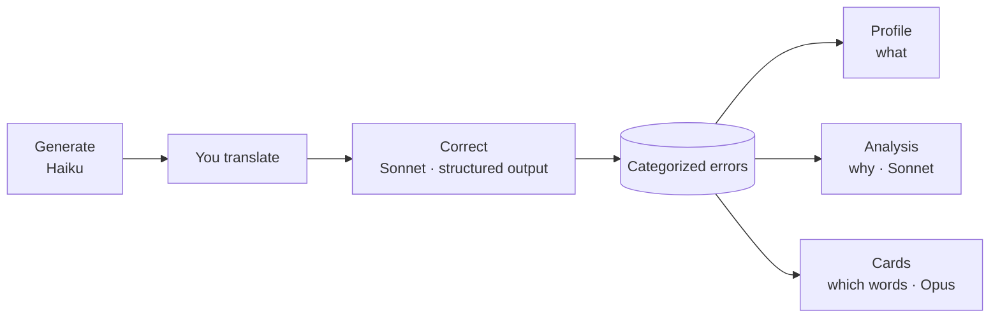

# WriteRight Architecture Haiku

One page on what the system is for and what shapes it. The reasoning behind each decision is in the [ADRs](decisions/).

## Objective

Help someone write better in another language by **remembering their mistakes**: every correction is classified and kept, and the history is read back as what to study next.

## Functional requirements

- **Practice:** generate a short text at a CEFR level, length and theme; the user translates it; the AI corrects it, marking every change inside the user's own text.
- **Error memory:** every error stored with a fixed category, a severity and an explanation.
- **Profile (what):** errors per 10 words over time; categories ranked by severity weight; the real errors behind each category.
- **Analysis (why):** patterns behind the categories, each one citing the errors that support it, with the cause and the rule to study.
- **Deck (which words):** vocabulary mistakes turned into flashcards, reviewed on a spaced-repetition schedule.
- **Habit and cost:** a day streak, and a report of what each AI operation costs (served by the API at `/api/usage`; there's no screen for it yet).

## Technical constraints

- **One user, local.** No authentication; SQLite; the API and the client run on the user's machine.
- **Paid per token** from pay-as-you-go API credit, not a subscription — every call has a visible price.
- **LLM output is non-deterministic:** the same text can come back with a different category or severity, and a model asked for advice will happily invent it.
- **Calls are not streamed,** so output is capped to fit the HTTP timeout; a timed-out call is billed and lost.

## Quality attributes, in priority order

1. **Integrity of the error history.** It's the product. Categories must stay comparable over time, and nothing the user did is physically deleted.
2. **Trustworthy AI output.** Nothing reaches the user as fact without a deterministic check: the schema constrains the correction, citations ground the analysis, a gate checks every card.
3. **Cost control.** Spend goes where a mistake is expensive, and every call records its tokens, model and duration.
4. **Usability.** Action screens are meant to fit a laptop window without scrolling, and nothing that waits on the AI blocks what doesn't need it.

## Design decisions

- **.NET 10 minimal API + Blazor WebAssembly**, sharing C# contracts through one class library, so the taxonomy can't drift between the database, the API and the UI. → [ADR 001](decisions/adr-001-dotnet-and-blazor-with-shared-contracts.md)
- **A closed taxonomy of 19 categories plus a separate severity axis**, enforced by structured output whose schema is generated from the enums. → [ADR 002](decisions/adr-002-closed-taxonomy-and-structured-output.md)
- **One model per task, chosen by measurement:** Haiku generates, Sonnet corrects and analyses at medium effort, Opus designs the cards at high effort. → [ADR 003](decisions/adr-003-one-model-per-task-chosen-by-measurement.md)
- **The analysis cites evidence and code checks it;** it reads error rows only, never the texts. → [ADR 004](decisions/adr-004-analysis-grounded-in-cited-evidence.md)
- **Cards decided by their own call and checked by code,** in a background queue that lives in the database. → [ADR 005](decisions/adr-005-cards-designed-by-their-own-call.md)
- **Soft delete and `RESTRICT` foreign keys**, so a deletion never takes facts with it. → [ADR 006](decisions/adr-006-soft-delete-and-restrict-foreign-keys.md)
- **No generation aimed at the profile:** the original core, removed when the data showed it couldn't reach its targets. → [ADR 007](decisions/adr-007-remove-profile-targeted-generation.md)

